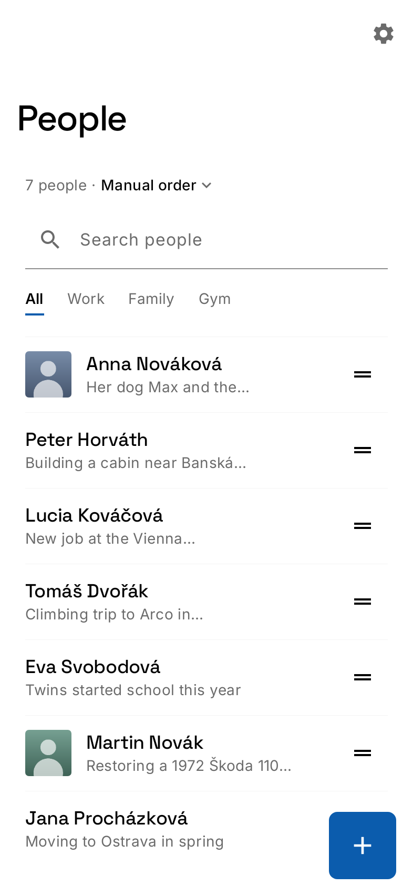
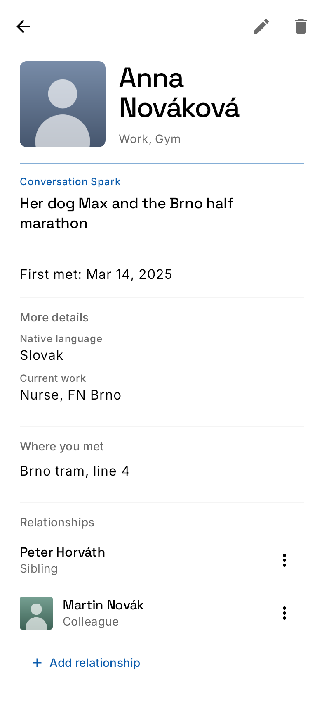
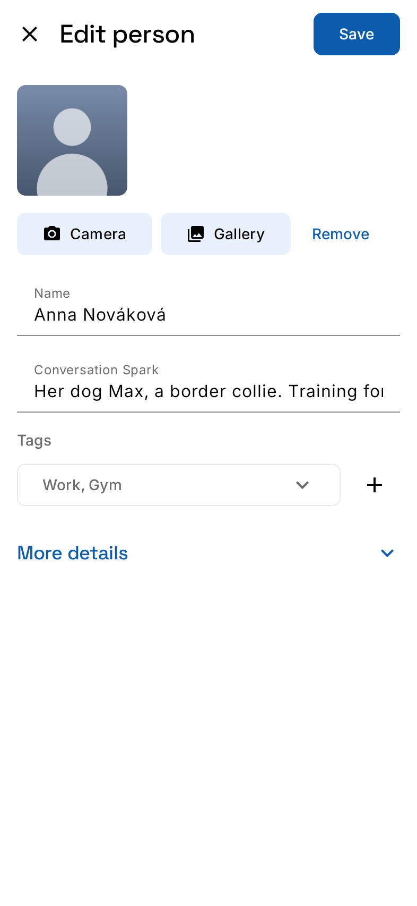
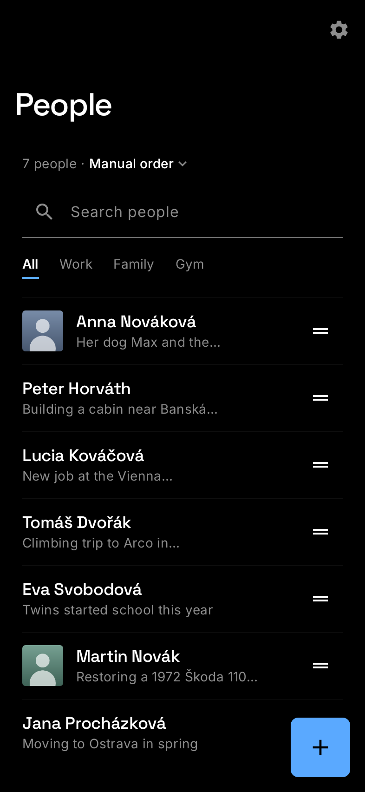
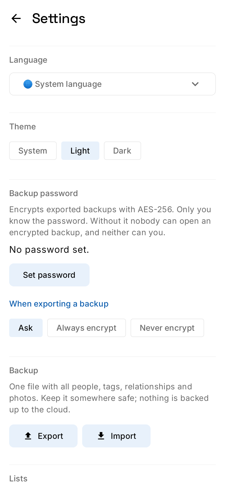
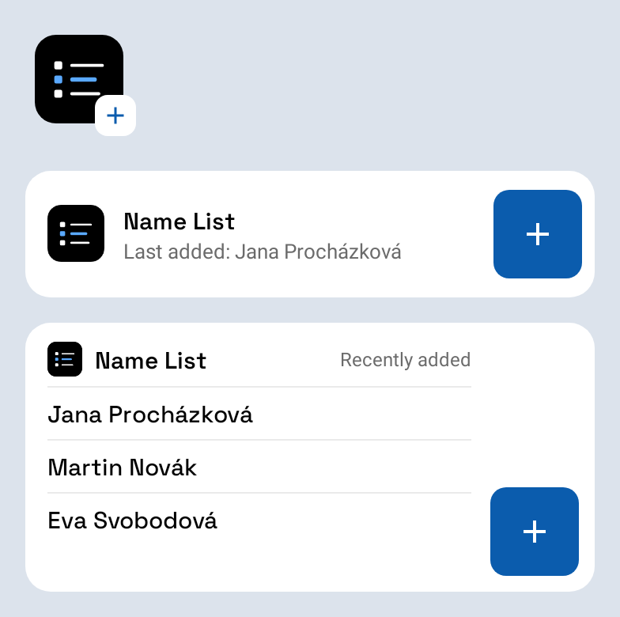

# MMr.NameList

A simple Android app to remember the people you meet. All data stays on your phone.

**Status:** 1.2.0 is the latest release; 1.3.0 is in testing. See the [changelog](CHANGELOG.md), [progress](docs/progress.md) and [releases](../../releases).

<table>
  <tr>
    <td></td>
    <td></td>
    <td></td>
  </tr>
  <tr>
    <td></td>
    <td></td>
    <td></td>
  </tr>
</table>

<sub>Screenshots of version 1.3.0, drawn by the tests from the real screens with fictional people. The two "photos" are drawn shapes, not people.</sub>

## About the app

You meet someone at a course, a party or on the tram. Two days later you see them again, and the name is gone. Name List is a small app for that moment: you write down the name and one thing to talk about, and the next time you meet you know both.

The future of remembering people should not need a social network, an account or the cloud. It should be quick, private and yours. That is the idea behind this app: one list of people, kept on your own phone, that you can open in a second and search by anything you wrote.

### What you can use it for

- **New people:** save the name in a few seconds, from the app or straight from the home-screen widget.
- **Conversation Spark:** one line on what to ask next time ("her dog Max", "the half marathon"), shown under the name in the list.
- **Context:** where and when you met, native language, work, education, birthday, notes, and a photo if you have one.
- **Groups:** tags such as Work, Family or Gym; a person can have several.
- **Relationships:** who is whose sibling, colleague or partner, with your own relationship types.
- **Finding people again:** search over every field and every date; sort A to Z or in your own order; a world map from a person's place.
- **Learning names:** rounds of 10 flash cards with random people; the details are on the front, the name is on the back; a chart shows your progress.
- **Clean-up:** an archive for people you do not see any more.

### Basic setup

1. Open [Releases](../../releases) on your Android phone and download the newest `MMr.NameList-<version>.apk`.
2. Open the file. If Android asks, allow installs from your browser or file manager for this one file.
3. Open **Name List**. There is no account and no sign-up; the list starts empty.
4. Optional: in **Settings** choose the language (English, Slovenčina, Čeština) and the theme (light, dark or as the phone).
5. Optional: add the widget. Long-press the home screen, choose **Widgets**, then **Name List**, and pick 1 x 1, 4 x 1 or 4 x 2.
6. From time to time: **Settings › Backup › Export** saves one file with all people, tags, relationships and photos. Keep it somewhere safe, and set a backup password if you want it encrypted.

To update, install the newer APK over the old one. Your data stays.

### Advantages

- **Private by design:** no account, no internet permission, no analytics, no ads. Nothing leaves the phone unless you export a backup.
- **Fast:** add a person from the widget in a few seconds; search while you type.
- **Made for conversations:** the Conversation Spark is right under each name.
- **Works offline:** the map, the fonts and everything else are inside the app.
- **Open source:** MIT licence; you can read every line.

### Disadvantages

- **Android only.** There is no iPhone or web version.
- **No sync.** Each phone has its own list; moving to a new phone means export and import.
- **No automatic backup.** If you lose the phone and did not export, the list is gone.
- **Not in the Play Store.** You install and update the APK yourself.
- **No reminders, no contacts import.** It is a memory aid, not an address book.
- **A simple map.** Country borders only, no streets.
- **Translations** into Slovak and Czech are not yet checked by a native speaker.

### Looking ahead

The app stays small on purpose. Ideas for later, not promises:

- a Play Store release, so updates come by themselves;
- an optional, encrypted backup to a folder or cloud drive of your choice;
- a quick "who did I meet this week" view.

## Features

| Area | Features |
|---|---|
| People | Fast name lists, search while typing, all-people view, A to Z or manual order |
| Photos | Take a photo or pick one from the gallery |
| Organization | Unlimited tags with unique names, several per person, drag and drop |
| Place of meeting | "City, state" text, or the current GPS position (stays on the phone) |
| Relationships | Two-way links between people and to you, with relationship types |
| Map | Offline world map with country borders; opens from a person's place |
| Multi-select | Select many people; delete them or move them to a tag at once |
| Privacy and backup | Local storage only; export and import one backup file, optionally encrypted with your password (AES-256) |
| Archive | Move people to an archive and restore them; the archive shows how long they have been there |
| Details | Conversation Spark, native language, date of birth, education, current work, date of first meeting, last updated |
| Look | "Line" design: white or black, thin lines, one blue accent; light, dark or system theme; English, Slovak, Czech |
| Widget | Add a person from the home screen; 1 x 1, 4 x 1 and 4 x 2 |
| Learning | Flash cards with 10 random people, knew or did not know, saved results and a progress chart |

Full list with IDs: [docs/requirements.md](docs/requirements.md).

## Technology

Kotlin, Jetpack Compose, Material 3, Room. Built and tested in GitHub Actions. No Android Studio necessary. Details: [docs/architecture.md](docs/architecture.md).

## Documentation

| Document | Content |
|---|---|
| [Requirements](docs/requirements.md) | What the app must do (F1 to F35, N1 to N5) |
| [Architecture](docs/architecture.md) | Stack, layers, data model, platform decisions, open decisions |
| [Design](docs/design.md) | Theme, colors, components, accessibility |
| [Milestones](docs/milestones.md) | Build plan M0 to M7, "done when" criteria, screenshot rules |
| [Decisions](docs/decisions.md) | Architecture Decision Records (ADR) |
| [Backup format](docs/backup-format.md) | The export file and the import rules |
| [Progress](docs/progress.md) | Current status and session log |
| [Milestone report template](docs/templates/milestone-report.md) | Format of each report to the owner |
| [Screenshots](docs/screenshots/README.md) | Screenshots of the current version, and of M0 to M3 |

## For AI agents

Start with [AGENTS.md](AGENTS.md). [CLAUDE.md](CLAUDE.md) points to the same file.

## Repository structure

```
.
|-- AGENTS.md              instructions for AI coding agents
|-- CLAUDE.md              points to AGENTS.md
|-- README.md              this file
|-- LICENSE                MIT
|-- docs/
|   |-- requirements.md
|   |-- architecture.md
|   |-- design.md
|   |-- milestones.md
|   |-- decisions.md
|   |-- progress.md
|   |-- templates/         report templates
|   `-- screenshots/       one folder per milestone
|-- .github/               CI workflows, PR and issue templates
|-- signing/               encrypted release keystore (ADR-008)
`-- app/                   Android app; app/schemas/ holds Room schemas
```

## Install on your phone

From milestone M0 on, each milestone has a GitHub release with a signed APK.

1. Open the [releases page](../../releases) on your Android phone.
2. Download the APK of the latest release.
3. Open it. If Android asks, allow installs from this source.

## Branches

- `master`: approved milestones only.
- `dev`: work in progress.

See [ADR-007](docs/decisions.md#adr-007-branches).

## License

[MIT](LICENSE)
